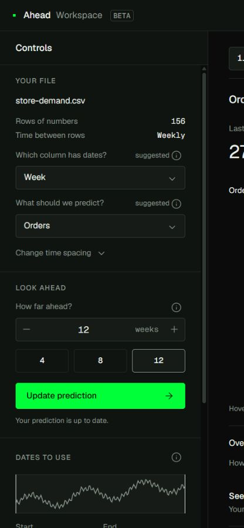

# Ahead

**See what could happen next.**

Upload past sales or orders, make a prediction, and check it against numbers you already know.



Ahead turns a regular sales, orders or traffic series into a forecast, a check against past data, and an exportable summary. Built with Python/FastAPI, pandas/NumPy and React/TypeScript/Vite/D3. It runs locally without accounts, API keys or model downloads.

The project began as TimesFM Forecaster. Ahead now defaults to an independent statistical engine because TimesFM 3 weights restrict commercial and production use. The official TimesFM integration remains available for research. See [product and revenue direction](docs/PRODUCT.md), [API contract](backend/API.md), and [verification](VALIDATION.md).

## Run locally

Requirements: Python 3.11+ and Node 20.19+ or 22+. From this directory, create and activate a virtual environment:

```sh
python -m venv .venv
```

PowerShell: `.venv\Scripts\Activate.ps1`. macOS/Linux: `source .venv/bin/activate`.

```sh
pip install -r backend/requirements.txt
```

Start backend (one command):

```sh
python -m uvicorn app.main:app --app-dir backend --host 127.0.0.1 --port 8000
```

In another terminal, install frontend dependencies once:

```sh
cd frontend
npm ci
```

Start frontend (one command):

```sh
npm run dev
```

Open the URL Vite prints, normally http://127.0.0.1:5173. Choose **Try an example**, then **Make prediction**. The synthetic store dataset includes 156 weekly observations. Inspect **Check with past data**, choose one or three windows, and export your CSV or summary. The frontend proxies `/api` to port 8000. Data is sent to this server; it is not browser-only processing.

## Build and serve the whole product

```sh
cd frontend
npm run build
```

This compiles TypeScript, bundles the workspace separately, and prerenders eight public pages. The same backend command above then serves `frontend/dist` at http://127.0.0.1:8000, including the API. Deep links work and unknown routes return HTTP 404. No frontend dev server is needed for the built app.

Public routes: `/`, `/use-cases/demand-planning`, `/guides`, `/guides/prepare-your-csv`, `/guides/read-a-forecast`, `/pricing`, `/privacy`, `/methodology`. Workspace: `/app` (noindex).

For a real deployment, set `SITE_URL` to the chosen HTTPS origin **before building**. PowerShell example: `$env:SITE_URL='https://your-domain.example'` (replace with your actual domain). Builds generate canonical/Open Graph metadata, structured data and a sitemap using that origin. Unconfigured local builds deliberately use noindex and disallow crawling. No domain or public deployment is provisioned by this source delivery. Serve the application behind HTTPS and a reverse proxy with upload/rate limits before opening it publicly.

## Configuration

| Variable | Default | Purpose |
| --- | --- | --- |
| `FORECAST_ENGINE` | `statistical` | Independent trend/seasonality model; `timesfm` enables research integration. |
| `APP_ENV` | `development` | `production` blocks restricted TimesFM weights. |
| `USE_MOCK_MODEL` | `0` | `1` overrides the engine with an explicitly labeled demo baseline. |
| `SITE_URL` | unset | Frontend build-time public HTTPS origin; enables indexing and canonical sitemap URLs. |
| `HF_HOME` | standard cache | Optional cache for research weights. |
| `HF_HUB_OFFLINE` | unset | `1` uses an already downloaded research checkpoint. |

`backend/.env.example` documents server settings. Environment files are not automatically read: set variables in your shell or use uvicorn `--env-file`.

### TimesFM research mode

Install `pip install -r backend/requirements-model.txt`, then set `FORECAST_ENGINE=timesfm`, `USE_MOCK_MODEL=0` and `APP_ENV=development` before restarting. PowerShell uses `$env:FORECAST_ENGINE='timesfm'`; POSIX shells use `export FORECAST_ENGINE=timesfm`.

The existing integration pins official `timesfm[torch]==3.0.2`, loads `google/timesfm-3.0-pytorch` once, and uses `TimesFM3Evaluator.predict_batch` with quantiles. CPU is default; CUDA is selected when available. First use downloads weights. Errors are shown explicitly; there is no silent model fallback. This mode requires substantial memory and is for research only: [official checkpoint license](https://huggingface.co/google/timesfm-3.0-pytorch/blob/main/LICENSE). The product does not bundle weights or claim Google endorsement.

## Forecast and backtest semantics

- CSV: UTF-8, up to 10 MB and 100,000 rows. One regular series per run, 30 valid points minimum, forecast horizon 1–256.
- Dates normalize to UTC; ISO dates are recommended. Duplicates keep the final row, not the sum. Aggregate transactions before upload.
- Training dates are inclusive. Counts shown before inference are locally parsed observations; server validation and regularization remain authoritative.
- Forecasts interpolate internal gaps up to three points. Edge gaps and larger gaps are rejected. Filled-point counts and warnings are returned.
- The independent engine fits a trend and seasonal phase means, using up to four seasons or 120 recent points. Seasonality requires three cycles. Its empirical residual range is not a calibrated probability guarantee. Negative predictions are retained.
- Backtests hold out one or three chronological windows. Each fold cleans and fits only its earlier training prefix. Missing held-out observations are rejected, never filled.
- Metrics: MAE in original units; sMAPE in percent, omitting zero/zero pairs (all zero returns null); MASE against the training seasonal-difference scale (zero/unavailable scale returns null); observed range coverage. Fold scores are averaged over equal-sized windows.
- Evidence labels are intentionally cautious. MASE below 1 compares against a training error scale; it does not prove victory over a baseline on future observations. See `/methodology`.
- Uploads are not saved by the application. Multipart may use temporary files, closed after reading. Hosting logs and retention need deployment-specific configuration.
- Two forecast/backtest jobs per server process are allowed concurrently. This bounds inference; it is not a public-service quota or distributed rate limiter.

## Checks

```sh
cd backend
python -m pytest -q
```

```sh
cd frontend
npm run build
```

No model weights are needed for tests. Source layout: `backend/app/data.py` for preparation; `forecast.py` for providers; `backtest.py` for chronological validation; frontend `src/product` for public pages; `src/components` and `src/hooks` for the workspace; `scripts/prerender.mjs` for static SEO pages.

## Roadmap and commercial boundary

Implemented: usable free beta, date selection, reliability checks, exports, public pages and SEO build. Planned: accounts, saved projects, scheduled refreshes, batch series, team collaboration and paid entitlements. Billing, ads and tracking are not installed. Public pricing labels planned features honestly; no nonfunctional checkout or fake signup form is present.

Ads may support editorial guides later; the forecasting workspace should remain free of ad distractions. See `docs/PRODUCT.md` for revenue hypotheses, acquisition metrics and launch gates. Ahead is a provisional name; verify domain and trademark availability before launch.

## Built with AI assistance

Developed by Hamza Farooq with Codex assistance for implementation, testing and documentation. The included examples are synthetic or public sample data; no customer outcomes or accuracy guarantees are claimed.

### Optional GitHub checks
The workflow template is in docs/checks-workflow.yml. Move it to .github/workflows/checks.yml with a GitHub credential that has workflow permission to enable CI. Local checks are documented above.
